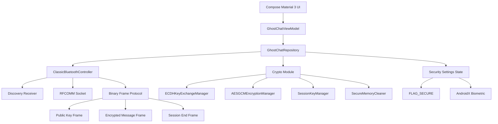

# System Architecture

## Data Flow

1. The discovery screen requests Bluetooth permissions and starts Bluetooth Classic discovery plus a server socket listener.
2. One device connects to a discovered peer; the other accepts the RFCOMM connection.
3. Both peers generate new ECDH key pairs and exchange public keys over Bluetooth.
4. Each peer derives the same 256-bit AES key using ECDH plus HKDF-SHA256.
5. Text messages are converted to UTF-8 bytes, encrypted with AES-256-GCM, framed, and sent over the socket.
6. Received frames are authenticated and decrypted before being added to the in-memory chat state.
7. Disconnect, panic, or timeout clears messages, destroys the session key, clears mutable buffers, and resets conversation state.
