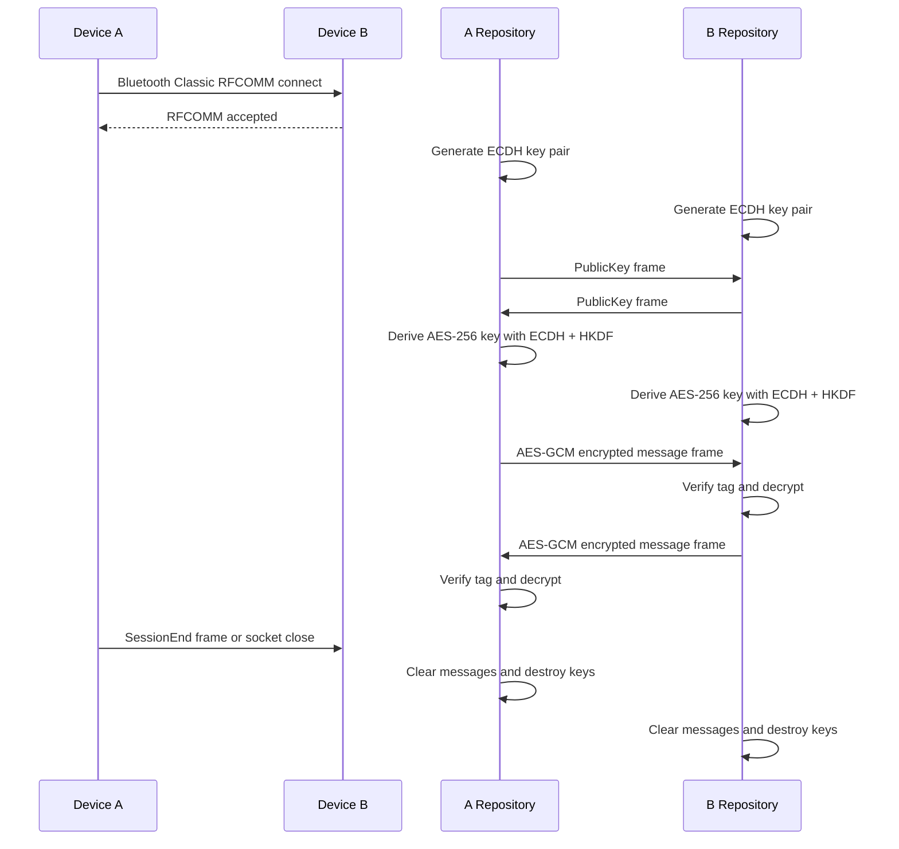

# Connection Sequence

## Frame Types

| Type | Payload |
| --- | --- |
| `1` | X.509 encoded ECDH public key |
| `2` | AES-GCM encrypted payload: nonce length, nonce, ciphertext+tag length, ciphertext+tag |
| `3` | Empty session-end signal |
